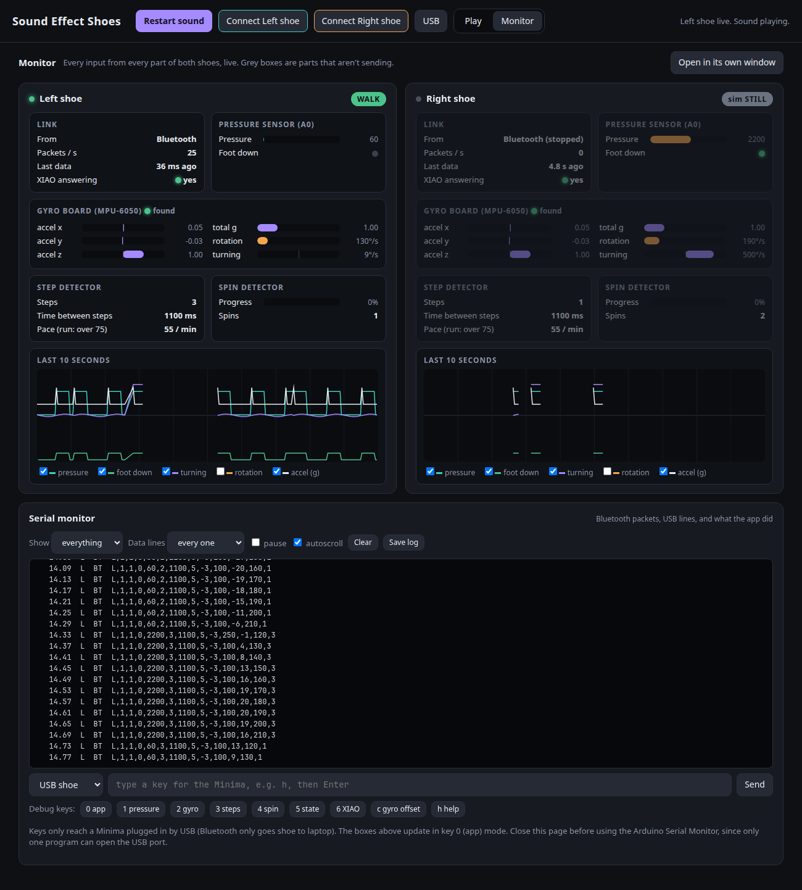

# Sound Effect Shoes

Two shoes that control sound effects on a laptop. Walk, run, stand still, or spin.

| Move | What the sound does |
|---|---|
| **Walk** | Plays at the normal volume |
| **Run** | Plays at max volume |
| **Stand still for 2 seconds** | Pauses (and picks up where it left off when you move) |
| **Spin 360** on one foot or both | Switches to the next of the 4 sounds |

Each shoe works out what it's doing by itself and sends it to the laptop. The app goes with the busiest shoe: if either shoe is running, it's loud, and it only pauses when **both** shoes are still. Both feet spinning together count as one spin.

The 4 built-in sounds are Rain, Ocean, Wind chimes and Campfire. Load your own file into any of them with **Load file**. Each sound also has a color, ready for the color sensor in the next version.

## Pictures

**The sound app** (left shoe live, right shoe on the simulator):


**The Monitor window**, with every input from every part:



**The real left-shoe build** in its 3D-printed tent case: the XIAO ESP32-C6 (small black board) and the MPU-6050 gyro (purple board, red light) on the breadboard, with the Arduino UNO R4 Minima underneath.


**Tinkercad wiring** for one shoe's breadboard: the XIAO (left), the gyro (right, bottom half), and the FSR with its resistor (top right).


## What's in this folder

| Folder | What it is | Goes on |
|---|---|---|
| `minima_foot/` | Reads the sensors, decides still / walk / run / spin | Each Arduino Minima |
| `xiao_radio/` | Sends it to the laptop by Bluetooth | Each XIAO ESP32-C6 |
| `sampler/` | The sound app, with the **Monitor** window | The laptop (open in Chrome) |
| `tests/` | One small test per part (see Debugging) | Minima, or the laptop |
| `tinkercad/` | The old Tinkercad practice model from the music version (doesn't work with the new app) | Tinkercad |

`minima_foot` is split into tabs, one per part:

| Tab | What it does |
|---|---|
| `config.h` | **Start here.** FOOT, parts on/off, and every threshold |
| `fsr_sensor.h` | Pressure sensor |
| `imu.h` | MPU-6050 gyro board |
| `motion.h` | Steps, spins, and still / walk / run / spin |
| `xiao_link.h` | Sending to the XIAO |
| `packet.h` | The 20 bytes each shoe sends (copied in `xiao_radio/`) |

Before you upload, set `FOOT` to `'L'` or `'R'` in `minima_foot/config.h`, and to `"L"` or `"R"` in `xiao_radio.ino`.

## Parts (for both shoes)

| Part | How many |
|---|---|
| Arduino UNO R4 Minima | 2 |
| Breadboard | 2 |
| XIAO ESP32-C6 (pre-soldered) | 2 (+1 spare) |
| GY-521 MPU-6050 gyro (pre-soldered) | 2 (+1 spare) |
| FSR pressure sensor | 2 (+1 spare) |
| Resistor for the FSR (220 ohm or 10k both work) | 2 |
| Jumper wires | a bunch |
| USB power bank + USB-C cable | 2 |

## Wiring (same on both shoes, unchanged from the music version)

**Pressure sensor (FSR), in the sole**
- One leg → 5V
- Other leg → A0
- Resistor from A0 → GND. The shoe learns how hard the wearer presses, so 220 ohm and 10k both work. 10k gives bigger numbers.

**Gyro (MPU-6050), on the breadboard**
- VCC → 5V, GND → GND
- SCL → Minima A5 (SCL), SDA → Minima A4 (SDA)
- It can sit any way up. The spin detector works out which way is up.

**XIAO, on the breadboard**
- 5V → Minima 5V, GND → Minima GND
- D4 → Minima SCL, D5 → Minima SDA
- No resistors. The XIAO shares the gyro's two wires, and the gyro board keeps them at a safe 3.3 V.

**Power:** power bank → Minima's USB-C port.

## Arduino IDE setup

1. Minima: Boards Manager → install "Arduino UNO R4 Boards" → pick *Arduino UNO R4 Minima*.
2. XIAO: File → Preferences → paste this in "Additional boards" →
   `https://raw.githubusercontent.com/espressif/arduino-esp32/gh-pages/package_esp32_index.json`
   Boards Manager → install "esp32 by Espressif" → pick *XIAO_ESP32C6*.
   Tools → USB CDC On Boot → Enabled.
3. Upload each XIAO **before** wiring it to the Minima.

## Opening the app

Bluetooth only works if you open it this way:
```
cd sampler
python3 -m http.server 8000
```
Then go to `http://localhost:8000` in Chrome. Press **Start sound**, then **Connect Left shoe** (`MusicShoe-L`) and **Connect Right shoe** (`MusicShoe-R`).

No shoes yet? Each shoe panel has simulator buttons (Still, Walk, Run, Spin 360), and the keyboard works too: `W` walk, `R` run, `X` still, `S` spin, `1`-`4` pick a sound.

## Debugging, one part at a time

### The Monitor window (in the app)

Click **Monitor** at the top, or **Open in its own window** to keep it next to the app. For each shoe it shows, live:

- **Link**: Bluetooth or USB, packets per second, time since the last data, and whether the XIAO is answering
- **Pressure sensor**: the raw number (0-4095) and whether the foot counts as down
- **Gyro board**: found or not, accelerometer x/y/z, total g, rotation speed, and turning speed (the number spins use)
- **Step detector**: step count, time between steps, steps per minute
- **Spin detector**: how far into a spin (%) and the spin count
- A 10-second plot of pressure, foot down, turning, rotation and g

Below that is the **serial monitor**: every packet, every event (state changes, spins, pause/resume, sound switches), and any text the Minima prints. You can filter it to one shoe or to events only, pause it, and save it to a file. With a Minima plugged in by **USB**, you can also type the debug keys below into it, or click the buttons.

### Debug keys (Arduino Serial Monitor at 115200, or the app's serial monitor over USB)

| Key | Shows |
|---|---|
| `0` | The app line (default). The app's Monitor boxes need this mode |
| `1` | Pressure sensor only: value, the press and release thresholds it learned, foot down |
| `2` | Gyro board only: accel x/y/z, g, gyro x/y/z, turning speed |
| `3` | Step detector only: steps, time between steps, steps per minute |
| `4` | Spin detector only: turning speed, angle so far, %, spins |
| `5` | The decision: state, step time vs the run limit, time left before "still" |
| `6` | XIAO link only: answering or not, sent / failed counts |
| `c` | Re-measure the gyro's resting offset (keep the shoe still) |
| `q` / `h` | Quiet / help |

Keys `1` to `5` print `name:value` pairs, so **Tools → Serial Plotter** draws them.

### Turning parts off

In `minima_foot/config.h`, set `USE_FSR`, `USE_IMU` or `USE_XIAO` to `0` and upload. The shoe keeps working without that part. With `USE_FSR 0`, steps come from hits on the gyro board instead. To try that while keeping the FSR on, set `STEPS_FROM_FSR 0`.

In `xiao_radio.ino`, set `DEMO_MODE 1` to test Bluetooth and the app with **no Minima**. The XIAO makes up still → walk → run → spin every 4 seconds. On the XIAO's own Serial Monitor, type `v` to print every packet it passes on.

### Test sketches (`tests/`)

| Sketch | Board | Checks |
|---|---|---|
| `fsr_test` | Minima | The pressure sensor alone: value, lowest, highest |
| `imu_test` | Minima (XIAO unplugged) | The gyro board alone: found or not, accel and gyro numbers |
| `i2c_scanner` | Minima | Who answers on SDA/SCL: the gyro (0x68) and the XIAO (0x08) |
| `logic_test` | Laptop | Runs `motion.h` on made-up walking, running, spinning and standing data |

Run the logic test on a laptop:
```
cd tests/logic_test
g++ -std=c++17 -I../../minima_foot logic_test.cpp -o logic_test && ./logic_test
```

### Suggested order the first time

1. App alone: open it, press Start sound, click the simulator buttons.
2. XIAO alone: upload with `DEMO_MODE 1`, connect it in the app, watch the Monitor.
3. Minima parts: `fsr_test`, then `imu_test`, then `i2c_scanner` with the XIAO plugged in.
4. Whole shoe over USB: upload `minima_foot`, click **USB** in the app, open Monitor. Walk, run and spin while holding the shoe, and press keys `1`-`6` to look at each part.
5. Whole shoe over Bluetooth: upload `xiao_radio` with `DEMO_MODE 0`, connect, play.

## Tuning (all in `minima_foot/config.h`)

| If... | Change |
|---|---|
| Fast walking counts as running | Lower `RUN_STEP_MS` (time between steps of one foot; walking is ~1000-1200, running ~600-750) |
| Running doesn't get loud | Raise `RUN_STEP_MS` |
| Steps are missed, or extra steps appear | Watch key `1`. Raise or lower `FSR_PRESS_FRAC` / `FSR_MIN_PRESS` |
| Spins don't count | Watch key `4`. Lower `SPIN_RATE_DPS` or `SPIN_DEG` |
| Turning around counts as a spin | Raise `SPIN_DEG` (keep it above 270) |
| Pauses too soon / too late | `STILL_MS` (2000 = 2 seconds) |
| Fidgeting stops the pause | Raise `MOVE_GYRO_DPS` / `MOVE_ACCEL_G` |

Walking and running volume are sliders in the app. The app's max is 100%, so turn the laptop's volume up too.

## If something goes wrong

- **`gyro NOT FOUND`** (key `2`, or the Monitor's gyro lamp is red): SDA and SCL are swapped, or VCC isn't plugged in. Try `imu_test`.
- **XIAO says `minima: NO DATA`**, or key `6` says `NOT ANSWERING`: check the D4/D5 wires and that the XIAO has 5V and GND. Try `i2c_scanner`.
- **"Bluetooth packet was N bytes, expected 20"** in the Monitor: the XIAO still has the old music code. Upload the new `xiao_radio`.
- **Shoe isn't in the Bluetooth list**: is the power bank on? Is FOOT right in both sketches?
- **The app can't open USB**: close the Arduino Serial Monitor first. Only one program can use the port.
- **Code won't upload to the XIAO**: hold BOOT, tap RESET, let go of BOOT, try again.
