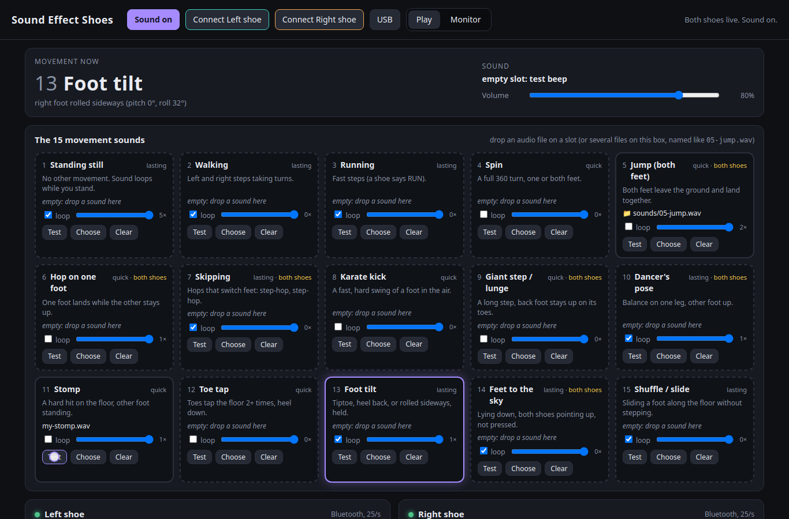

# Sound Effect Shoes

Two shoes that control sound effects on a laptop. Walk, run, stand still, or spin.

| Move | What the sound does |
|---|---|
| **Walk** (left and right feet taking turns) | Plays at the normal volume |
| **Run** (taking turns, fast) | Plays at max volume |
| **No step for 2 seconds** | Pauses (and picks up where it left off when you walk again) |
| **Spin 360** on one foot or both | Switches to the next of the 4 sounds |

Only steps count: tilting, shaking or rocking a shoe never plays sound. Each shoe counts its own steps (a press on the pressure sensor) and sends them to the laptop. With both shoes connected, the app only plays when the feet **take turns**: at least 2 left-right switches in the last 3 seconds, each 0.15 to 1.5 seconds apart. Both feet landing together (a hop) doesn't count. If either shoe's steps are fast enough to be running, it's loud. With one shoe connected (for testing), that shoe's own steps count. The turn rule can be switched off in the app. Both feet spinning together count as one spin.

The 4 built-in sounds are Rain, Ocean, Wind chimes and Campfire. Load your own file into any of them with **Load file**. Each sound also has a color, ready for the color sensor in the next version.

## Pictures

**The sound app** (left shoe live, right shoe on the simulator):



**The Monitor window**, with every input from every part:


**The real left-shoe build** in its 3D-printed tent case: the XIAO ESP32-C6 (small black board) and the MPU-6050 gyro (purple board, red light) on the breadboard, with the Arduino UNO R4 Minima underneath. (That was the old two-board build. Each shoe now uses only the XIAO.)


**Tinkercad wiring** for one shoe's breadboard: the XIAO (left), the gyro (right, bottom half), and the FSR with its resistor (top right).


## What's in this folder

Each shoe has **one board now: the XIAO ESP32-C6**. It reads the sensors and sends Bluetooth itself. The Arduino UNO R4 Minima is no longer used. Rewiring steps are in the XIAO-only rewiring guide.

| Folder | What it is | Goes on |
|---|---|---|
| `xiao_foot/` | Reads the sensors, decides still / walk / run / spin, sends it by Bluetooth | Each XIAO ESP32-C6 |
| `sampler/` | The sound app, with the **Monitor** window | The laptop (open in Chrome) |
| `tests/` | One small test per part (see Debugging) | XIAO, or the laptop |
| `tinkercad/` | The old Tinkercad practice model from the music version (doesn't work with the new app) | Tinkercad |

`xiao_foot` is split into tabs, one per part:

| Tab | What it does |
|---|---|
| `config.h` | **Start here.** FOOT, parts on/off, demo mode, and every threshold |
| `fsr_sensor.h` | Pressure sensor |
| `imu.h` | MPU-6050 gyro board |
| `motion.h` | Steps, spins, and still / walk / run / spin |
| `packet.h` | The 20 bytes each shoe sends |

Before you upload, set `FOOT` to `'L'` or `'R'` in `xiao_foot/config.h`. The Bluetooth name becomes `MusicShoe-L` or `MusicShoe-R`, the same as before, so the app is unchanged.

## Parts (for both shoes)

| Part | How many |
|---|---|
| Breadboard | 2 |
| XIAO ESP32-C6 (pre-soldered) | 2 (+1 spare) |
| GY-521 MPU-6050 gyro (pre-soldered) | 2 (+1 spare) |
| FSR pressure sensor | 2 (+1 spare) |
| 10k resistor for the FSR | 2 |
| 100 uF capacitor (optional) | 2 |
| Jumper wires | a bunch |
| USB power bank + USB-C cable | 2 |

## Wiring (same on both shoes)

Everything runs on **3.3 V from the XIAO's 3V3 pin**. **Never use the XIAO's 5V pin.**

- **Rails:** XIAO 3V3 → breadboard + rail, XIAO GND → − rail.
- **Pressure sensor (FSR):** one leg → + rail, other leg → XIAO **D0**, 10k resistor from D0 → − rail.
- **Gyro (MPU-6050):** VCC → + rail, GND → − rail, SDA → XIAO **D4**, SCL → XIAO **D5**. Leave XDA, XCL, AD0 and INT empty. It can sit any way up.
- **Power:** power bank → the XIAO's USB-C port.
- Later, the TCS34725 color sensor goes on the same SDA/SCL wires (address 0x29).

## Uploading to the XIAO

1. One-time setup: File → Preferences → paste this in "Additional boards manager URLs":
   `https://raw.githubusercontent.com/espressif/arduino-esp32/gh-pages/package_esp32_index.json`
   Then Boards Manager → install "esp32 by Espressif".
2. Plug the XIAO into the laptop with a USB-C data cable.
3. Tools → Board → esp32 → **XIAO_ESP32C6**. Tools → USB CDC On Boot → **Enabled**. Tools → Port → the `usbmodem` one.
4. First upload `tests/xiao_sensor_test` and open the Serial Monitor at **115200**. All lines should say PASS (press the FSR once). Then upload `xiao_foot`.
5. No port, or the upload fails: hold the XIAO's **B** (BOOT) button, tap **R** (RESET), let go of B, and upload again.

## Opening the app

Bluetooth only works if you open it this way:
```
cd sampler
python3 -m http.server 8000
```
Then go to `http://localhost:8000` in Chrome. Press **Start sound**, then **Connect Left shoe** (`MusicShoe-L`) and **Connect Right shoe** (`MusicShoe-R`).

No shoes yet? Each shoe panel has simulator buttons (Still, Walk, Run, Spin 360), and the keyboard works too: `W` walk, `R` run, `X` still, `S` spin, `1`-`4` pick a sound.

## Debugging, one part at a time

### The Monitor window (in the app)

Click **Monitor** at the top, or **Open in its own window** to keep it next to the app. For each shoe it shows, live:

- **Link**: Bluetooth or USB, packets per second, time since the last data, and whether the XIAO is answering (always yes now)
- **Pressure sensor**: the raw number (0-4095) and whether the foot counts as down
- **Gyro board**: found or not, accelerometer x/y/z, total g, rotation speed, and turning speed (the number spins use)
- **Step detector**: step count, time between steps, steps per minute
- **Spin detector**: how far into a spin (%) and the spin count
- A 10-second plot of pressure, foot down, turning, rotation and g

Below that is the **serial monitor**: every packet, every event (state changes, spins, pause/resume, sound switches), and any text the shoe prints. You can filter it to one shoe or to events only, pause it, and save it to a file. With a XIAO plugged in by **USB** (the app's **USB** button), you can also type the debug keys below into it, or click the buttons.

### Debug keys (Arduino Serial Monitor at 115200, or the app's serial monitor over USB)

| Key | Shows |
|---|---|
| `0` | The app line (default). The app's Monitor boxes need this mode |
| `1` | Pressure sensor only: value, the press and release thresholds it learned, foot down |
| `2` | Gyro board only: accel x/y/z, g, gyro x/y/z, turning speed |
| `3` | Step detector only: steps, time between steps, steps per minute |
| `4` | Spin detector only: turning speed, angle so far, %, spins |
| `5` | The decision: state, step time vs the run limit, time left before "still" |
| `6` | Bluetooth only: connected or waiting, packets sent |
| `c` | Re-measure the gyro's resting offset (keep the shoe still) |
| `q` / `h` | Quiet / help |

Keys `1` to `5` print `name:value` pairs, so **Tools → Serial Plotter** draws them.

### Turning parts off

In `xiao_foot/config.h`, set `USE_FSR` or `USE_IMU` to `0` and upload. The shoe keeps working without that part. With `USE_FSR 0`, steps come from hits on the gyro board instead. To try that while keeping the FSR on, set `STEPS_FROM_FSR 0`.

Set `DEMO_MODE 1` to test Bluetooth and the app with **no sensors**. The XIAO makes up still → walk → run → spin every 4 seconds.

### Test sketches (`tests/`)

| Sketch | Board | Checks |
|---|---|---|
| `xiao_sensor_test` | XIAO | **Start here.** Everything at once with PASS / FAIL: I2C scan (and SDA/SCL swapped), gyro, color sensor if fitted, pressure sensor. Type `c` to check again |
| `fsr_test` | XIAO | The pressure sensor alone: value, lowest, highest (Serial Plotter works) |
| `imu_test` | XIAO | The gyro board alone: found or not, accel and gyro numbers |
| `i2c_scanner` | XIAO | Who answers on SDA/SCL: the gyro (0x68), later the color sensor (0x29) |
| `logic_test` | Laptop | Runs `motion.h` on made-up walking, running, spinning and standing data |

Run the logic test on a laptop:
```
cd tests/logic_test
g++ -std=c++17 -I../../xiao_foot logic_test.cpp -o logic_test && ./logic_test
```

### Suggested order the first time

1. App alone: open it, press Start sound, click the simulator buttons.
2. Sensors: upload `tests/xiao_sensor_test` and get PASS on every line.
3. Whole shoe over USB: upload `xiao_foot`, click **USB** in the app, open Monitor. Walk, run and spin while holding the shoe, and press keys `1`-`6` to look at each part.
4. Whole shoe over Bluetooth: close the USB connection, connect `MusicShoe-L` / `MusicShoe-R`, play.

## Tuning (all in `xiao_foot/config.h`)

| If... | Change |
|---|---|
| Fast walking counts as running | Lower `RUN_STEP_MS` (time between steps of one foot; walking is ~1000-1200, running ~600-750) |
| Running doesn't get loud | Raise `RUN_STEP_MS` |
| Steps are missed, or extra steps appear | Watch key `1`. Raise or lower `FSR_PRESS_FRAC` / `FSR_MIN_PRESS` |
| Spins don't count | Watch key `4`. Lower `SPIN_RATE_DPS` or `SPIN_DEG` |
| Turning around counts as a spin | Raise `SPIN_DEG` (keep it above 270) |
| Pauses too soon / too late | `STILL_MS` (2000 = 2 seconds) |
| Tilting the shoe still counts steps | Watch key `1` while tilting. If the pressure jumps when the sole bends, raise `FSR_MIN_PRESS` above that number |
| Walking takes too long to start | In `sampler/index.html`, lower `TURNS_NEEDED` to 1 |

Walking and running volume are sliders in the app. The app's max is 100%, so turn the laptop's volume up too.

## If something goes wrong

- **`gyro NOT FOUND`** (key `2`, or the Monitor's gyro lamp is red): SDA and SCL are swapped, or VCC isn't plugged in. Run `xiao_sensor_test`, which says if they're swapped.
- **Pressure stays at 0**: the FSR's wires or its D0 wire aren't in the same breadboard row. **Pressure stuck near 4095**: the 10k resistor to the − rail is missing.
- **Shoe isn't in the Bluetooth list**: connect from the app's Connect button, not macOS Bluetooth settings. Open the app at `http://localhost:8000` in Chrome, and allow Chrome under System Settings > Privacy & Security > Bluetooth. Key `6` should say "advertising, waiting for the laptop". If it says "NOT advertising", or the boot line says BROWNOUT, it's a power problem: try a USB cable straight from the laptop. Still missing? Install nRF Connect (free) on a phone and scan: if `MusicShoe-L` shows up there, the shoe is fine and the problem is on the laptop side. Quit Chrome fully and try again.
- **The shoe switches off after ~30 seconds**: the power bank turns itself off at low current. Use its "always on" / low-current mode.
- **The app can't open USB**: close the Arduino Serial Monitor first. Only one program can use the port.
- **Code won't upload to the XIAO**: hold BOOT, tap RESET, let go of BOOT, try again.
