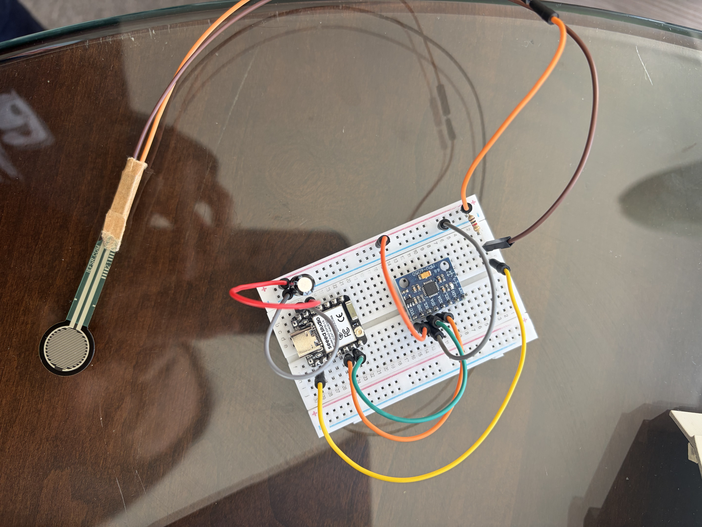
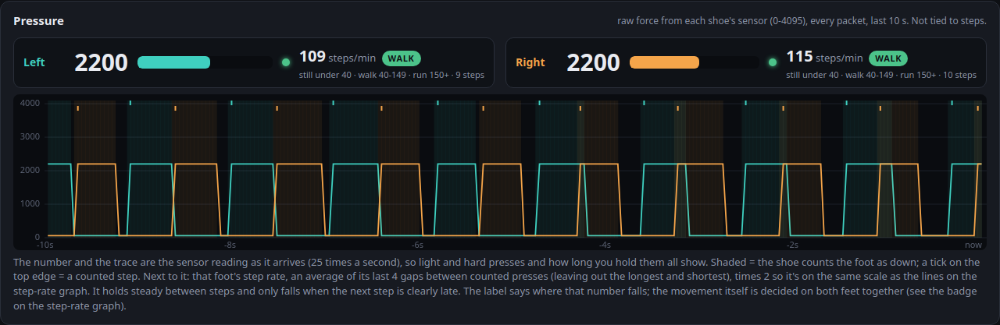
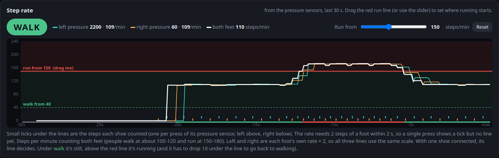

# Sound Effect Shoes

Two shoes that play a different sound for each of **15 movements**. Each shoe has a XIAO ESP32-C6, an MPU-6050 gyro board and one pressure sensor (FSR) in the sole, and streams to the laptop app over Bluetooth.

> **Not tested on real shoes yet.** The movement detection compiles for the XIAO ESP32-C6 (esp32 core 3.3.12) and passes the laptop tests (`tests/logic_test`, `tests/movement_test`), but every threshold is a first guess. Expect to tune them (see [Tuning the movements](#tuning-the-movements)).

Testing happens in three phases. Phase 1 is the goal, phase 2 and 3 test the two sensors on their own.

## Phase 1: all movements

The shoes detect 15 movements. **Each one has its own sound slot** in the sound app (`sampler/index.html`), and every slot starts empty.

| # | Movement | Kind | Needs |
|---|---|---|---|
| 1 | Standing still | lasting | one shoe |
| 2 | Walking | lasting | one shoe (both: feet must take turns) |
| 3 | Running | lasting | one shoe |
| 4 | Spin (360) | quick | one shoe |
| 5 | Jump with both feet | quick | **both shoes** |
| 6 | Hop on one foot | quick | **both shoes** |
| 7 | Skipping | lasting | **both shoes** |
| 8 | Karate kick | quick | one shoe |
| 9 | Giant step / lunge | quick | **both shoes** |
| 10 | Dancer's pose (balance on one leg) | lasting | **both shoes** |
| 11 | Stomp | quick | one shoe |
| 12 | Toe tap | quick | one shoe |
| 13 | Foot tilt (tiptoe, heel back, rolled sideways) | lasting | one shoe |
| 14 | Both feet to the sky (lying down) | lasting | **both shoes** |
| 15 | Shuffle / slide | lasting | one shoe |


**Only one movement sound plays at a time.** A new movement stops the old sound. Quick moves play their sound once and stay "now" for 0.9 s; lasting moves loop their sound while you keep doing them (each slot has a **loop** box to change that). How hard you press is not an output.

Fill a slot by dropping an audio file on it, clicking **Choose**, or putting files in `sampler/sounds/` named like `05-jump.wav` (see [Adding your sounds](#adding-your-sounds)). Until then, **Beep for empty slots** plays a short test tone per movement so you can hear what's detected. Every slot also has a **Test** button that pretends the movement happened. How each movement is worked out: [The movements](#the-movements-how-each-one-is-detected).

## Phase 2: force sensor (walk vs run)

The pressure sensor (FSR) in each sole counts steps. Walking vs running comes from how fast the steps come, not from how hard they are.

- **A step** is the sole pressing down. The shoe learns the "foot up" (rest) and "full press" (peak) readings, and counts a step when pressure rises 40% of the way from rest to peak (`FSR_PRESS_FRAC`). The foot counts as up again under 20% (`FSR_RELEASE_FRAC`). Readings under 150 (`FSR_MIN_PRESS`) never count, and two steps closer than 250 ms (`STEP_MIN_MS`) are one.
- **Step rate** is in steps per minute, both feet counted: each foot's rate is the average of its last 4 gaps between steps, times 2.
- **Thresholds:** still under 40 steps/min (or no step for about 2 s), walk from 40, **run from 150** (`RUN_SPM`, back to walking under 140). People walk at about 100-120 and run at 150-180.
- **In the sound app** (Play view): the **Pressure** panel shows each shoe's raw reading (0-4095) live, with a trace and its steps/min labelled STILL / WALK / RUN. The **Step rate** graph shows the last 30 s with the run line, which you can drag to tune it (saved in the browser). Details: [The pressure panel](#the-pressure-panel-raw-force-from-each-shoe) and [The step-rate graph](#the-step-rate-graph-setting-walk-vs-run).

## Phase 3: gyro (current)

The MPU-6050 on each shoe measures tilt, spin and air time.

- **Tilt:** pitch (toes down / heel down) and roll (sideways) in degrees from flat, measured against the "flat" saved when the shoe calibrates. More than 20° (`TILT_DEG`) is tiptoe, heel or side; toes up more than 60° (`SKY_PITCH_DEG`) is pointing at the sky.
- **Spin:** turning speed around the up/down line. Turning faster than 120 °/s (`SPIN_RATE_DPS`) through 330° (`SPIN_DEG`) within 3 s is one spin.
- **Air time:** how long the shoe is close to **weightless** (total acceleration under 0.4 g for at least 40 ms, `AIR_FREEFALL_G`), ended by a landing hit or by returning to normal gravity. This is **free fall, not height**: a foot that is lifted and held up still reads about 1 g, so it is not "in the air". Only jumps, hops and running strides with both feet off the ground give air time.

To see these numbers live, the gyro test page (`sampler/gyro.html`) graphs pitch, roll, yaw rate, total turn and air time for each shoe; see [The gyro test page](#the-gyro-test-page).

## Current breadboard

One shoe's breadboard as it is now: the XIAO ESP32-C6 (left, USB-C), the MPU-6050 gyro board (right), and the FSR on its leads (far left). Wiring is in [Wiring](#wiring-same-on-both-shoes).



## Pictures

**The sound app**: the movement playing now, and the 15 sound slots (here with made-up packets from both shoes; slot 5 has a file from `sampler/sounds/`, slot 11 a dropped file):


**The Monitor window**, with every input from every part:


**The pressure panel** (Play view): raw force from each shoe's sensor as it arrives, here while walking:



**The step-rate graph** (Play view): steps per minute from each shoe's pressure sensor over the last 30 s, walking, then running, then walking again:



**An earlier left-shoe build** in its 3D-printed tent case: the XIAO ESP32-C6 (small black board) and the MPU-6050 gyro (purple board, red light) on the breadboard, with the Arduino UNO R4 Minima underneath. (That was the old two-board build. Each shoe now uses only the XIAO.)


**Tinkercad wiring** for one shoe's breadboard: the XIAO (left), the gyro (right, bottom half), and the FSR with its resistor (top right).


## What's in this folder

Each shoe has **one board now: the XIAO ESP32-C6**. It reads the sensors and sends Bluetooth itself. The Arduino UNO R4 Minima is no longer used. Rewiring steps are in the XIAO-only rewiring guide.

| Folder | What it is | Goes on |
|---|---|---|
| `xiao_foot/` | Reads the sensors, works out this foot's gait, pose and one-foot events, sends them by Bluetooth | Each XIAO ESP32-C6 |
| `sampler/` | The sound app (`index.html`), the two-foot movement logic (`movements.js`), and a `sounds/` folder for your files | The laptop (open in Chrome) |
| `tests/` | One small test per part (see Debugging) | XIAO, or the laptop |
| `tinkercad/` | The old Tinkercad practice model from the music version (doesn't work with the new app) | Tinkercad |

`xiao_foot` is split into tabs, one per part:

| Tab | What it does |
|---|---|
| `config.h` | **Start here.** FOOT, parts on/off, demo mode, which way the gyro board faces, and every one-foot threshold |
| `fsr_sensor.h` | Pressure sensor |
| `imu.h` | MPU-6050 gyro board |
| `motion.h` | Steps, spins, still / walk / run / spin, foot pose, and stomp / toe tap / kick / shuffle |
| `packet.h` | The 20 bytes each shoe sends |

Before you upload, set `FOOT` to `'L'` or `'R'` in `xiao_foot/config.h`. The Bluetooth name is `MusicShoe-L` or `MusicShoe-R`. Also set `FORWARD_AXIS` / `FORWARD_SIGN` to match how the gyro board sits (see [Setting up the gyro direction](#setting-up-the-gyro-direction)).

**Update both shoes and the app together.** The 20-byte packet changed (it's still 20 bytes, so it fits one Bluetooth message), so an old shoe with the new app, or a new shoe with the old app, shows nonsense.

## Parts (for both shoes)

| Part | How many |
|---|---|
| Breadboard | 2 |
| XIAO ESP32-C6 (pre-soldered) | 2 (+1 spare) |
| GY-521 MPU-6050 gyro (pre-soldered) | 2 (+1 spare) |
| FSR pressure sensor | 2 (+1 spare) |
| 10k resistor for the FSR | 2 |
| 100 uF capacitor (optional) | 2 |
| Jumper wires | a bunch |
| USB power bank + USB-C cable | 2 |

## Wiring (same on both shoes)

**Pressure sensor (FSR), in the sole**
- One leg → the XIAO **3V3** pin. Never 5V.
- Other leg → **D0**
- 10k resistor from D0 → GND

**Gyro (MPU-6050), on the breadboard**
- VCC → 3V3
- GND → GND
- SDA → **D4**
- SCL → **D5**
- I2C address **0x68**. No extra resistors. The XIAO is the only board; the Minima is gone.

Color sensor is not wired yet. **D1** and **D2** are reserved for a later TCS34725 (LED and INT).

## Uploading to the XIAO

1. One-time setup: File → Preferences → paste this in "Additional boards manager URLs":
   `https://raw.githubusercontent.com/espressif/arduino-esp32/gh-pages/package_esp32_index.json`
   Then Boards Manager → install "esp32 by Espressif".
2. Plug the XIAO into the laptop with a USB-C data cable.
3. Tools → Board → esp32 → **XIAO_ESP32C6**. Tools → USB CDC On Boot → **Enabled**. Tools → Port → the `usbmodem` one.
4. First upload `tests/xiao_sensor_test` and open the Serial Monitor at **115200**. All lines should say PASS (press the FSR once). Then upload `xiao_foot`.
5. No port, or the upload fails: hold the XIAO's **B** (BOOT) button, tap **R** (RESET), let go of B, and upload again.

## Opening the app

Bluetooth only works if you open it this way:
```
cd sampler
python3 -m http.server 8000
```
Then go to `http://localhost:8000` in Chrome. Press **Start sound**, then **Connect Left shoe** (`MusicShoe-L`) and **Connect Right shoe** (`MusicShoe-R`).

### The pressure panel: raw force from each shoe

The **Pressure** panel (Play view, above the step-rate graph) shows each shoe's sensor reading as it arrives, 25 times a second: a big number (0-4095) and a bar per foot, plus a 10 s trace. It is not tied to steps, so holding, light presses and hard presses all show. Shaded areas are where the shoe counts the foot as down, and ticks on the top edge are counted steps. Under each number: the time between that foot's last two counted presses and its step count. The same raw number is next to "left / right pressure" on the step-rate graph and in each shoe's box lower down.

Rough readings with the FSR wired from 3.3 V to D0 and 10k to GND: nothing on it 0-100, a light finger touch a few hundred, a firm press 1500-3000, a hard squeeze or standing on it 3500-4095.

The Monitor log (set to **movements only**) has a line for every counted step, e.g. `>>> Left step #12 (pressure 2200, 1080 ms after this foot's last step = 111 steps/min on the graph)`. A press that moves the number but adds no line didn't cross the shoe's press level: press key `1` on the shoe to see `fsr`, `pressAt`, `releaseAt` and `rest`.

### The step-rate graph: setting walk vs run

The **Step rate** panel draws steps per minute over the last 30 s: left (teal), right (orange) and both feet together (white). Left and right are each foot's own rate times 2, so all three use the same scale (people walk at about 100-120 steps/min and run at 150-180). The green dashed line is the slowest walk (40/min), the red line is where running starts. The badge shows STILL / WALK / RUN now, and the strip along the bottom shows it over time.

**Drag the red line** up or down (or use the **Run from** slider) to set where running starts. It works right away and is saved in this browser; **Reset** puts it back to 150. To go back to walking the rate has to drop 10 below the line, so it doesn't flicker when you're right on it.

How the rate is worked out: each foot's rate is the average of its last 4 gaps between counted presses, leaving out the longest and shortest (so one missed or extra step barely moves it), times 2. With both shoes the two are averaged. It holds steady between steps and only falls once the next step is 1.5 gaps late. The Pressure panel shows each foot's rate in steps/min with a STILL / WALK / RUN label and the lines (still under 40, run from the red line). Expect RUN about 2.5 s after you speed up, WALK about 2 s after you slow down, and STILL about 2 s after the last step.

No shoes yet? Click **Test** on any slot to pretend that movement happened. With `DEMO_MODE 1` in `config.h`, a shoe with no sensors makes up still, walk, run, spin, each pose and each one-foot event, 3 seconds each.

### The gyro test page

Open `http://localhost:8000/gyro.html` (or the **Gyro test page** link at the top of the sound app). Connect the shoes there to see, per shoe over the last 30 s: pitch, roll, yaw rate, the turn added up from the yaw rate (360° = one spin, **Zero turn** resets it), and air time from the accelerometer only (the shoe is weightless in the air: the last time in the air, plus how long it has been in the air right now; tune with `AIR_*` in `config.h`), with the numbers beside each graph. A shoe can only be connected to one page at a time.

## Adding your sounds

Each of the 15 slots is empty until you give it a sound. Three ways:

1. **Drag and drop** an audio file (WAV, MP3, OGG, M4A) onto a slot. It's saved in this browser (IndexedDB), so it's still there after a reload. **Clear** removes it.
2. **Drop several files at once** onto the slots box. Each one goes to the slot its name matches: a number first (`05-...`) or the movement's name (`jump`, `toetap`, `karate kick`...).
3. **A folder:** put files in `sampler/sounds/` named `<number>-<key>.<mp3|wav|ogg|m4a>`. The full list of names is in [`sampler/sounds/README.md`](sampler/sounds/README.md), e.g. `01-still.mp3`, `05-jump.wav`, `12-toetap.ogg`, `15-shuffle.wav`. They load when the page opens (it has to be opened through `python3 -m http.server`). A dropped sound wins over a folder one.

Each slot also has a **loop** box and its own volume. The master volume is at the top.

## The movements: how each one is detected

Each shoe works out what **it** can see by itself (100 times a second) and sends it to the laptop 25 times a second. The app (`sampler/movements.js`) combines both shoes for the moves that need two feet, and picks the one movement that plays.

**What each shoe sends:** its step count (a step = the sole pressing down, which is also every landing), how long the foot was in the air before its last step, whether the foot is down right now, walk / run / still / spin, its **pose**, and one-foot **events**.

**Pose** (`motion.h` `PoseTracker`): the shoe saves "flat" when it measures the gyro offset at power-on (and with key `c`). From then on it measures **pitch** (toes up +, toes down −) and **roll** (sideways) against flat, using `FORWARD_AXIS` to know where the toes are. Pose is `TIPTOE` (pitch below −`TILT_DEG`), `HEEL` (pitch above `TILT_DEG`), `SIDE` (roll beyond `TILT_DEG`), `SKY` (toes up more than `SKY_PITCH_DEG`, or turned over more than `SKY_FLIP_DEG`, sole facing the ceiling), else `FLAT`. A new pose has to last `POSE_HOLD_MS`.

| # | Movement | Where | How it's detected |
|---|---|---|---|
| 1 | Standing still | app | Nothing else is happening (the default). Silence unless you give it a sound |
| 2 | Walking | shoe + app | Each shoe counts steps (as before). With both shoes, the feet must take turns: `TURNS_NEEDED` left-right switches in `TURN_WINDOW_MS`, each `TURN_MIN_MS`-`TURN_MAX_MS` apart. With one shoe, 2+ steps of that shoe |
| 3 | Running | app | Walking, and the step rate is at or above `RUN_SPM` steps/min (both feet counted, default 150). Set it live on the **Step rate** graph |
| 4 | Spin | shoe | 360° of turning around the up/down line within `SPIN_WINDOW_MS` (as before). Both feet spinning together = one spin |
| 5 | Jump | app | Both feet land within `JUMP_LAND_TOGETHER_MS` of each other, after both were in the air together for `JUMP_MIN_AIR_MS`-`JUMP_MAX_AIR_MS` |
| 6 | Hop | app | One foot lands after `HOP_MIN_AIR_MS`-`HOP_MAX_AIR_MS` in the air, and the other foot was up the whole time (lifted before the hop took off) and is still up. Waits `JUMP_LAND_TOGETHER_MS` first, in case it's a jump |
| 7 | Skipping | app | A hop on one foot, then a hop on the other foot within `SKIP_WINDOW_MS` (step-hop, step-hop). Lasts `SKIP_HOLD_MS` after each hop. The first hop of a skip plays the hop sound |
| 8 | Karate kick | shoe | Foot off the ground at least `KICK_MIN_AIR_MS`, rotating faster than `KICK_GYRO_DPS` and accelerating harder than `KICK_G`. Once per lift, not while running. The app ignores it if the other foot is also in the air |
| 9 | Lunge | app | A foot lands after a long swing (`LUNGE_MIN_AIR_MS`+) and stays down, while the other foot stays up on its toes (`TIPTOE` pose) for `LUNGE_HOLD_MS` without stepping, and you weren't already walking |
| 10 | Dancer's pose | app | One foot down for `DANCER_HOLD_MS`, the other foot up for `DANCER_HOLD_MS` (and not pointing at the sky) |
| 11 | Stomp | shoe | A hit harder than `STOMP_G` within `STOMP_WINDOW_MS` after the foot presses down, not while running. The app only counts it if the other foot has been standing for `OTHER_FOOT_DOWN_MS` (so a jump or hop landing isn't a stomp) |
| 12 | Toe tap | shoe | The toes come down faster than `TAP_RATE_DPS` and hit the floor harder than `TAP_G` (but softer than `STOMP_G`), without a real step (sole up less than `TAP_MAX_LIFT_MS`). `TAP_COUNT` taps within `TAP_WINDOW_MS` = toe tap, then every further tap. The app ignores it while walking or with the other foot in the air |
| 13 | Foot tilt | shoe + app | A shoe in `TIPTOE`, `HEEL` or `SIDE` pose for `TILT_HOLD_MS`, that foot hasn't stepped for `TILT_QUIET_MS`, and you're not walking |
| 14 | Feet to the sky | app | Both shoes in `SKY` pose and not pressed, for `SKY_HOLD_MS` |
| 15 | Shuffle / slide | shoe | Sole touching (any pressure), shoe flat, not turning, no step for `SHUFFLE_NO_STEP_MS`, and `SHUFFLE_PUSHES` pushes along the floor harder than `SHUFFLE_G`, each within `SHUFFLE_GAP_MS` of the last. Lasts `SHUFFLE_HOLD_MS` after each one |

When several lasting moves are true at once, the app picks in this order: test button, feet to the sky, dancer's pose, skipping, shuffle, running, walking, tilt, still. A quick move always cuts in and holds for `EVENT_HOLD_MS`.

**Where the FSR sits matters.** Under the heel, tiptoe and a lunge's back foot read as "foot up". Under the ball of the foot, toe taps also count as steps. Both work with the defaults, but watch key `7` and the Monitor while you tune.

## Debugging, one part at a time

### The Monitor window (in the app)

Click **Monitor** at the top, or **Open in its own window** to keep it next to the app. For each shoe it shows, live:

- **Link**: Bluetooth or USB, packets per second, time since the last data
- **Pressure sensor**: the raw number (0-4095), whether the foot counts as down, and whether it's touching at all
- **Gyro board**: found or not, pitch, roll, peak g since the last packet, rotation speed, turning speed (the number spins use), and the pose
- **Step detector**: step count, time between steps, time in the air before the last step, steps per minute
- **Spin and events**: how far into a spin (%), spin count, and the last one-foot event
- A 10-second plot of pressure, foot down, turning, rotation, peak g and pitch

Below that is the **serial monitor**: every packet, every pose change and one-foot event a shoe reports, and **every movement the app detected, with the reason** (for example `>>> 5 JUMP (BOTH FEET): both feet landed 47 ms apart, 283 ms in the air together`, or `>>> left STOMP ignored: right foot was in the air too (a jump or hop landing)`). Choose **movements only** to see just those lines. You can filter to one shoe, pause, and save to a file. With a XIAO plugged in by **USB** (the app's **USB** button), you can also type the debug keys below into it, or click the buttons.

The Play view also shows, for each shoe, its gait, pose, foot down, pitch/roll, last event and air time, and each slot counts how many times its movement fired.

### Debug keys (Arduino Serial Monitor at 115200, or the app's serial monitor over USB)

| Key | Shows |
|---|---|
| `0` | The app line (default). The app's Monitor boxes need this mode |
| `1` | Pressure sensor only: value, the press and release thresholds it learned, foot down |
| `2` | Gyro board only: accel x/y/z, g, gyro x/y/z, turning speed |
| `3` | Step detector only: steps, time between steps, steps per minute |
| `4` | Spin detector only: turning speed, angle so far, %, spins |
| `5` | The decision: state, step time vs the run limit, time left before "still" |
| `6` | Bluetooth only: connected or waiting, packets sent |
| `7` | Movements: pitch, roll, flip, pitch rate, g×10, rotation, push along the floor ×100, down, touching, air time, taps and pushes counted, pose and gait. Also prints every landing |
| `c` | Re-measure the gyro's resting offset **and "flat"** (shoe flat on the floor, still) |
| `q` / `h` | Quiet / help |

Keys `1` to `5` and `7` print `name:value` pairs, so **Tools → Serial Plotter** draws them. In modes `0`, `5` and `7` the shoe also prints a line for each one-foot event and pose change, like `# L STOMP (4.3)`, `# R TOE TAP (2.0)`, `# L pose TIPTOE (pitch -27, roll 3)`. The number after an event is what made it fire: peak g for a stomp, taps for a toe tap, deg/s for a kick, pushes for a shuffle.

### Turning parts off

In `xiao_foot/config.h`, set `USE_FSR` or `USE_IMU` to `0` and upload. The shoe keeps working without that part. With `USE_FSR 0`, steps come from hits on the gyro board instead. To try that while keeping the FSR on, set `STEPS_FROM_FSR 0`.

Set `DEMO_MODE 1` to test Bluetooth and the app with **no sensors**. Every 3 seconds the XIAO makes up the next of: still, walk, run, spin, tiptoe, heel, side, sky, stomp, toe tap, kick, shuffle.

Movement detection needs **both** parts. Without the gyro board there's no pose, spin, kick, toe tap, stomp or shuffle. Without the FSR, "foot down" comes from hits on the gyro board, so jump, hop, lunge, dancer's pose and feet to the sky won't work.

### Test sketches (`tests/`)

| Sketch | Board | Checks |
|---|---|---|
| `xiao_sensor_test` | XIAO | **Start here.** Everything at once with PASS / FAIL: I2C scan (and SDA/SCL swapped), gyro, color sensor if fitted, pressure sensor. Type `c` to check again |
| `fsr_test` | XIAO | The pressure sensor alone: value, lowest, highest (Serial Plotter works) |
| `imu_test` | XIAO | The gyro board alone: found or not, accel and gyro numbers |
| `i2c_scanner` | XIAO | Who answers on SDA/SCL: the gyro (0x68), later the color sensor (0x29) |
| `logic_test` | Laptop | Runs `motion.h` on made-up data: walk, run, spin, still, every pose, stomp, kick, toe tap, shuffle, and things that must not count |
| `movement_test` | Laptop (Node) | Runs `sampler/movements.js` on made-up packets from both shoes: all 15 movements, plus walking/running not being jumps or hops, jump landings not being stomps, one shoe only |

Run them on a laptop:
```
cd tests/logic_test
g++ -std=c++17 -I../../xiao_foot logic_test.cpp -o logic_test && ./logic_test
cd ../..
node tests/movement_test/movement_test.js            # VERBOSE=1 in front shows what the app logs
```

### Suggested order the first time

1. App alone: open it, press Start sound, click **Test** on a few slots (you'll hear the test beeps).
2. Sensors: upload `tests/xiao_sensor_test` and get PASS on every line.
3. Whole shoe over USB: upload `xiao_foot`, click **USB** in the app, open Monitor. Walk, run and spin while holding the shoe, and press keys `1`-`7` to look at each part.
4. Whole shoe over Bluetooth: close the USB connection, connect `MusicShoe-L` / `MusicShoe-R`, play.

## Setting up the gyro direction

Pose, toe tap, tilt, lunge and feet to the sky need to know which way the toes point.

1. In `config.h`, set `FORWARD_AXIS` to the axis printed on the GY-521 that points to the toes (`0` = X, `1` = Y, `2` = Z), and `FORWARD_SIGN` to `1` if the arrow points to the toes or `-1` if it points to the heel. Upload.
2. Power on (or press `c`) with the shoe **flat on the floor** and still. That saves "flat".
3. Press `7`. Lift the toes: `pitch` should go **up** (positive). Go up on tiptoe: `pitch` goes **negative**. Roll the shoe onto its side: `roll` changes.
4. If `roll` moves when you lift the toes, you have the wrong axis. If `pitch` goes the wrong way, flip `FORWARD_SIGN`. If the boot message warns that `FORWARD_AXIS` points up/down, pick another axis.

## Tuning the movements

One-foot numbers are in **`xiao_foot/config.h`** (upload again after changing them). Two-foot numbers and timing are in the **`TUNING` block at the top of `sampler/movements.js`** (just reload the page). Watch key `7` on the shoe and the Monitor's serial monitor (set to **movements only**) while you try each move. It says what fired, and what was ignored and why.

| If... | Change |
|---|---|
| Fast walking counts as running | Drag the red line on the **Step rate** graph up (or `RUN_SPM` in the app's `TUNING`). The shoe's own `RUN_STEP_MS` only affects what key `5` and the Monitor show |
| Running isn't detected | Drag the red line down. Kids and short legs step faster, so they may need 160-170 |
| Steps are missed, or extra steps appear | Watch key `1` (`fsr` against `pressAt` / `releaseAt` / `rest`). Raise or lower `FSR_PRESS_FRAC` / `FSR_MIN_PRESS`. Light steps missed after a hard one: lower `FSR_PEAK_HALF_MS` |
| Spins don't count | Watch key `4`. Lower `SPIN_RATE_DPS` or `SPIN_DEG` |
| Turning around counts as a spin | Raise `SPIN_DEG` (keep it above 270) |
| Still takes too long / too short | `STILL_MS` (shoe) and `STOP_MS` (app) |
| Tilting the shoe still counts steps | Watch key `1` while tilting. If the pressure jumps when the sole bends, raise `FSR_MIN_PRESS` above that number |
| Walking takes too long to start | `TURNS_NEEDED` to 1 (app) |
| Jumps are missed | Watch the landings with key `7`. Raise `JUMP_LAND_TOGETHER_MS` (feet land further apart than you think) or lower `JUMP_MIN_AIR_MS` (app) |
| Running counts as hops | Lower `HOP_OTHER_UP_SLACK_MS` (app) |
| Hops are missed | Raise `HOP_OTHER_UP_SLACK_MS`, lower `HOP_MIN_AIR_MS` (app) |
| Skipping keeps dropping back to walking | Raise `SKIP_HOLD_MS` or `SKIP_WINDOW_MS` (app) |
| Stomps are missed / normal steps stomp | Key `7` shows `g10` (g × 10) at each landing. Set `STOMP_G` between a normal step and a stomp (shoe) |
| Toe taps are missed | Key `7`: look at `pitchRate` (needs to go below −`TAP_RATE_DPS`) and `g10` at the tap. Lower `TAP_RATE_DPS` / `TAP_G`. If the FSR is under the ball, raise `TAP_MAX_LIFT_MS` a bit (shoe) |
| Walking makes toe taps | Lower `TAP_MAX_LIFT_MS`, raise `TAP_COUNT` (shoe) |
| Kicks are missed / big steps kick | Key `7`: `gyro` and `g10` during the kick. Move `KICK_GYRO_DPS` / `KICK_G` (shoe) |
| Lunges are missed | Check the back foot shows `TIPTOE` (key `7`). Lower `LUNGE_MIN_AIR_MS` or `LUNGE_HOLD_MS` (app), or `TILT_DEG` (shoe) |
| Dancer's pose too slow / too eager | `DANCER_HOLD_MS` (app) |
| Tilt is too sensitive / not enough | `TILT_DEG` and `TILT_EXIT_DEG` (shoe), `TILT_HOLD_MS` (app) |
| Feet to the sky is missed | Key `7` with the shoe pointing up: `pitch` must pass `SKY_PITCH_DEG`, or `flip` pass `SKY_FLIP_DEG` (shoe). Both shoes must also read 0 pressure. `SKY_HOLD_MS` (app) |
| Shuffles are missed | Key `7`: `push100` while sliding must pass `SHUFFLE_G` × 100 and `touch` must stay 1. Lower `SHUFFLE_G` or `SHUFFLE_PUSHES` (shoe) |
| Quick move sounds get cut off too soon | Raise `EVENT_HOLD_MS` (app) |

Volume: each slot has its own volume, plus the master volume at the top. The app's max is 100%, so turn the laptop's volume up too.

## If something goes wrong

- **`gyro NOT FOUND`** (key `2`, or the Monitor's gyro lamp is red): SDA and SCL are swapped, or VCC isn't plugged in. Run `xiao_sensor_test`, which says if they're swapped.
- **Pressure stays at 0**: the FSR's wires or its D0 wire aren't in the same breadboard row. **Pressure stuck near 4095**: the 10k resistor to the − rail is missing.
- **Shoe isn't in the Bluetooth list**: connect from the app's Connect button, not macOS Bluetooth settings. Open the app at `http://localhost:8000` in Chrome, and allow Chrome under System Settings > Privacy & Security > Bluetooth. Key `6` should say "advertising, waiting for the laptop". If it says "NOT advertising", or the boot line says BROWNOUT, it's a power problem: try a USB cable straight from the laptop. Still missing? Install nRF Connect (free) on a phone and scan: if `MusicShoe-L` shows up there, the shoe is fine and the problem is on the laptop side. Quit Chrome fully and try again. In Chrome, `chrome://bluetooth-internals` → Devices → Start scan lists everything the laptop hears, with signal strength. macOS often shows a shoe under an **old name** (e.g. the name of a sketch it ran before, or the other shoe's name): in the Connect popup, pick any shoe listed. The app asks the shoe which foot it is and uses it as that foot, and the log says so. If macOS Bluetooth settings list `MusicShoe-L` (or an old name for it), click **Forget This Device**, then turn Bluetooth off and on.
- **The shoe switches off after ~30 seconds**: the power bank turns itself off at low current. Use its "always on" / low-current mode.
- **The app can't open USB**: close the Arduino Serial Monitor first. Only one program can use the port.
- **Code won't upload to the XIAO**: hold BOOT, tap RESET, let go of BOOT, try again.
